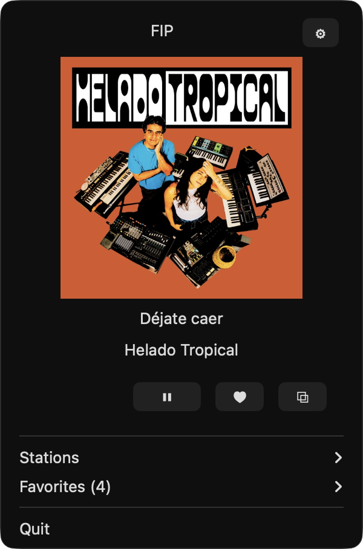
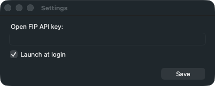

# Fiplet


[FIP](https://www.radiofrance.fr/fip) ([France Inter Paris](https://fr.wikipedia.org/wiki/FIP_(radio))) is originally a French public radio station run by
Radio France. It's known for broadcasting music exclusively, ad-free and
around the clock, and for an eclectic playlist — curated by humans, not
algorithms — that makes it easy to discover new sounds. Think of it as a
free, ad-free alternative to Spotify with a particularly refined musical
selection.

FIP now offers several web-radios by genre, and you'll find all of them here.

## Screenshots

<p align="center">
  
  <br/>
  <em>The menu-bar mini-player — cover art, title/artist, play/pause, ♥ (like) and ⧉ (copy) — above the Stations / Favorites / Quit menu.</em>
</p>

<p align="center">
  
  <br/>
  <em>Settings: your Open FIP API key and the "Launch at login" option.</em>
</p>

A **lightweight, standalone** FIP player for the macOS menu bar. Plays the
**13 FIP webradios** and shows the current track via the **Radio France open
API**, plus a local **like**.

> **Unofficial project.** This is an independent, community-made app. It is
> **not** an official Radio France product and is not affiliated with,
> sponsored by, or endorsed by Radio France.

## Features

- **13 FIP webradios**, one click away in the menu bar.
- **Now playing**: title, artist and **cover art** (with an API key — see below).
- **Cover art in Control Center** and on the **lock screen**, plus hardware
  **media keys** (play/pause, next/previous station).
- **♥ Like** the current track, and **remove** a favorite by **double-clicking**
  it in the list.
- **⧉ Copy** the current track ("Artist — Title") to the clipboard.
- **Remembers the last station** and reopens on it.
- **Auto-reconnects** if the live stream drops, with an *"offline"* hint.
- Optional **launch at login** (stays silent when opened automatically at
  startup — it only auto-plays when you open it yourself).


## Menu contents

A **♪** icon in the menu bar opens a **menu** (`NSMenu`):

- **Mini-player**: radio name + gear ⚙, cover art, title, artist, ▶/⏸, ♥ (like)
  and ⧉ (copy the current track).
- **"Radios" submenu**: the 13 webradios (the current station is checkmarked).
- **"Favoris (N)" submenu**: the liked tracks; **double-click** one to remove it.
- **Quitter**.

## API key — strongly recommended

To get the most out of the app, it is **strongly recommended** to use your
**own** Radio France open API key. Without a key, every webradio **still plays**,
but the app shows **no track information** (title, artist) and **no cover art**
— it does not use any built-in token to fetch metadata.

Getting a key is **free**: you just need to create a **developer account** on
the [Radio France open API portal](https://developers.radiofrance.fr), then copy
the token it gives you.

**On first launch**, the Settings window opens automatically so you can paste
the key. Once it is saved, titles, artists and cover art appear, and the window
no longer reopens. You can reopen Settings at any time via the gear ⚙.

## Cover art

Radio France's API returns the track's title and artist, but not artwork, so
covers are fetched separately: for each new track the app queries the public
**iTunes Search API** with "artist title" (stripped of `(Remaster)`, `[Live]`,
`feat.` … qualifiers to improve matching), keeps the first match and loads its
artwork (upgraded to 600×600). Because this relies on the resolved title/artist,
**cover art also requires the API key**. When no match is found, the player
simply shows no image. The cover is also published to **Control Center** and the
**lock screen**.

## A note about the audio streams

FIP is famously **ad-free**. However, the **official Radio France audio streams**
used by this app begin with a **~30-second audio advert** at the very start of
playback; after that initial ad, no more follow. Oddly, this pre-roll does
**not** occur in the stream served on Radio France's own website. The app plays
the official streams as they are provided and neither adds nor removes anything.

If the stream drops (network blip, server hiccup), the app **reconnects to the
live edge automatically** and briefly shows an *"offline — reconnecting…"* hint.

## ♥ Like

The ♥ button saves the current track to `likes.json`; saved tracks appear in the
**"Favoris"** submenu. To **remove** one, **double-click** its row — a single
click does nothing, so you can't delete by accident, and the menu stays open.

The **⧉** button copies the current track ("Artist — Title", or just the title)
to the clipboard.

## Requirements

- macOS 11+ on **Apple Silicon (ARM: M1, M2, M3, …)**. Intel Macs are not
  currently supported.
- Stable Rust.

## Run / install

```bash
cargo run --release
# or build the app:
./bundle.sh
open "FIP.app"        # or: cp -r "FIP.app" /Applications/
```

`bundle.sh` signs the app ad-hoc. To open it on **another** Mac (the app is not
notarized), clear the quarantine flag once:
`xattr -dr com.apple.quarantine '/Applications/FIP.app'`.

## Configuration

| Variable | Purpose | Default |
|---|---|---|
| `RADIOFRANCE_TOKEN` | Radio France open API token | *(none — metadata disabled until a key is set)* |

The key entered in Settings is persisted in
`~/Library/Application Support/fip-menubar-light/settings.json`.
Likes are stored in `likes.json` in the same folder.

## Architecture

| File | Role |
|---|---|
| `src/main.rs` | entry point: `ui::run()` |
| `src/ui.rs` | native AppKit interface (`NSStatusItem` + `NSMenu`, Radios/Favoris submenus) |
| `src/audio.rs` | live AAC stream decoded internally (`ureq` + symphonia → rodio), with auto-reconnect |
| `src/metadata.rs` | GraphQL `live` poller (polling aligned on `song.end`) + iTunes cover lookup |
| `src/likes.rs` | local likes: add / remove (writes `likes.json`) |
| `src/config.rs` | API token + last station + `settings.json` |
| `src/stations.rs` | table of the 13 stations |
| `src/model.rs` | shared types |

Two worker threads (audio, metadata); their `AppEvent`s are drained by an
`NSTimer` on the main thread. No async runtime, no subprocess.

> The container is an `NSMenu` (not an `NSPopover`): a menu that is being opened
> keeps the menu bar revealed on top of a full-screen app, which the popover did
> not do.

## License

The **code** is released under the [MIT License](LICENSE).

This does **not** cover Radio France's intellectual property: the name **"FIP"**,
the **FIP logo/icon**, and the audio streams and metadata served by Radio France
remain the property of Radio France and are used here only to interoperate with
their public services. See the unofficial-project notice at the top of this file.
